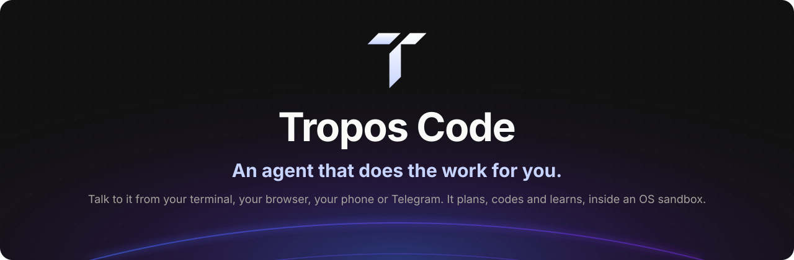

<p align="center">
  
</p>

<p align="center">
  <a href="#quickstart"><strong>Quickstart</strong></a> ·
  <a href="docs/README.md"><strong>Docs</strong></a> ·
  <a href="https://github.com/Tropos-AI/tropos-code"><strong>GitHub</strong></a> ·
  <a href="https://troposlabs.com"><strong>Website</strong></a>
</p>

<p align="center">
  <a href="LICENSE"></a>
  <a href="https://github.com/Tropos-AI/tropos-code/releases/latest"></a>
  <a href="https://github.com/Tropos-AI/tropos-code/actions/workflows/ci.yml"></a>
  <a href="https://github.com/Tropos-AI/tropos-code/stargazers"></a>
</p>

<p align="center">
  
</p>

```sh
curl -fsSL https://troposlabs.com/install.sh | sh
```

<br>

## What is Tropos Code?

**Tropos Code is an agent that does the work for you.** You tell it what you want, in your terminal, in your
browser, on your phone or in Telegram, and it reads, edits and runs code in your projects, sets itself up, and
remembers what it learns about you and your work. It asks before anything risky, and the commands it runs from a
chat are confined to the project by the operating system.

It is one program, `tcode`, by [Tropos Labs](https://troposlabs.com). Run it in a terminal for a coding session, or
let it run in the background as a **gateway** that answers Telegram, serves a web **dashboard** on this computer,
runs your scheduled jobs and checks in when something needs you.

You don't need to edit config files: `tcode onboard` walks you through setup, the dashboard has every setting, and
you can simply ask the agent ("connect my Telegram bot", "add the GitHub MCP server", "use a cheaper model for
this").

<br>

## Features

<table>
<tr>
<td align="center" width="33%"><h3>💬 Telegram</h3>Send a task from Telegram and approve its edits and commands with buttons. Nobody gets in until you approve them.</td>
<td align="center" width="33%"><h3>🖥️ Dashboard and phone</h3>A web dashboard on <code>127.0.0.1:4317</code>, also on your phone through Tailscale, never on the open internet.</td>
<td align="center" width="33%"><h3>🧭 A chief and its specialists</h3>The agent you talk to leads; specialists with their own role, model, memory and skills do focused work. <code>@name</code> talks to one directly.</td>
</tr>
<tr>
<td align="center"><h3>🧠 Learns as you talk</h3>It keeps notes about you and the work, a daily journal, and skills for procedures. Every save is shown and can be undone.</td>
<td align="center"><h3>🔧 Configures itself</h3>Ask it to connect Telegram, add a project, an MCP server, a plugin or a skill, or switch models. Each change asks first and is recorded.</td>
<td align="center"><h3>🖼️ Images, files and texts</h3>Paste, drop or attach images and text files; vision models see them. On a Mac it can also read and send your texts, asking before each one (off by default).</td>
</tr>
<tr>
<td align="center"><h3>🛡️ Autonomy with an OS sandbox</h3>Ask, Balanced or Autonomous. A chat's commands run inside <code>sandbox-exec</code> (macOS) or <code>bwrap</code> (Linux), or Docker.</td>
<td align="center"><h3>🔌 Any model provider</h3>Anthropic, OpenAI, xAI, DeepSeek, OpenRouter, Gemini, Ollama and 10 more built in, plus any OpenAI- or Anthropic-compatible endpoint.</td>
<td align="center"><h3>⏰ Scheduled work</h3>"Every weekday at 9, summarise the open PRs." Jobs run in their project and report to your chat; a heartbeat messages you only when it matters.</td>
</tr>
</table>

<br>

## Quickstart

Tropos Code runs on macOS and Linux (arm64 and x64).

```bash
curl -fsSL https://troposlabs.com/install.sh | sh
```

Or with Homebrew: `brew install tropos-ai/tap/tcode` ([how Homebrew installs are updated](docs/install.md#with-homebrew)).

The installer verifies a signed manifest and the binary's checksum before it runs anything, installs `tcode` to
`~/.local/bin`, and on a fresh install with a terminal starts the guided setup. If it didn't (no terminal, or
`--no-onboard`), run it yourself:

```bash
tcode onboard      # provider key, model, name, projects, autonomy, Telegram, phone, run at login
tcode dashboard    # open the web dashboard, logged in
tcode              # or start a coding session in this terminal
```

Release key fingerprint: SHA256:QY3xHG6gCBN84NfeYw1Vy1r5G0NpGTf0jDR02/QVLr8

Updates are automatic: new releases install by themselves, and the background service restarts into each one when
nothing is running ([Updates and rollback](docs/updates.md)).

Verifying the installer before running it, installer flags and what the installer changes on your machine:
[docs/install.md](docs/install.md). A first walk-through: [Getting started](docs/getting-started.md).

<br>

## How you use it

| Where | How |
|---|---|
| **Terminal** | `tcode` starts an interactive session in the current directory; `tcode -p "…"` answers once, for scripts and CI. |
| **Dashboard** | `tcode dashboard` opens chat with live tool calls and diffs, your projects, schedule, skills, agents, memory, extensions, status and settings. |
| **Telegram** | Connect a bot in setup; message it from anywhere. `/project` switches project, `/stop` stops a turn, `/new` starts over. |
| **Phone** | Turn on phone access (Tailscale) and log your phone in with a 6-digit code. |

```bash
tcode "add a --json flag to the export command"     # interactive, starting with a prompt
git diff | tcode -p "review this diff" --output-format json
tcode -c                                            # continue the last session here
tcode status                                        # what is running, and whether it is healthy
```

<br>

## How it keeps you safe

- **You approve risky actions.** In the terminal, edits and commands ask unless your settings allow them. In a chat,
  the [autonomy level](docs/autonomy-and-sandbox.md) decides what runs unasked; MCP tools and changes to Tropos's
  own setup always ask, and a chat can lower its level but never raise it.
- **A chat's commands are confined.** They run in the project's directory under `sandbox-exec` (macOS) or `bwrap`
  (Linux): writes only to the project and temp folders, no reads of `~/.ssh`, `~/.aws`, keychains, browser profiles,
  shell histories, your other projects' `.env` files or `~/.tropos`, and only an allowlisted environment, so tokens
  your shell exports never reach them.
- **Nobody is in by default.** An unknown Telegram sender gets a one-time code that you approve on this computer.
  Guests work in their own folder, and their commands run only in Docker.
- **Secrets stay out of the conversation.** A key pasted into a chat is sealed before the model, the transcript or the
  search index sees it, and Telegram's copy of the message is deleted. Shell commands never inherit
  `ANTHROPIC_API_KEY` or any variable that looks like a credential.
- **Repos can't configure your agent.** Allow rules, hooks, MCP servers, plugins and provider addresses are read only
  from `~/.tropos`; a cloned repo can add instructions, commands, skills and stricter rules, nothing that runs a
  program or widens what the agent may do.
- **The dashboard stays on this computer.** It listens on `127.0.0.1` only, checks `Host` and `Origin`, sends a
  strict CSP, and each browser logs in once with a one-time link or a 6-digit code.
- **Releases are signed.** Every install and update checks an ed25519-signed manifest and the binary's SHA-256.

The full threat model, roles and limits: [docs/security.md](docs/security.md). To report a vulnerability, see
[SECURITY.md](SECURITY.md).

<br>

## How it works

```
 terminal (tcode)        dashboard (127.0.0.1:4317, phone via Tailscale)        Telegram
        │                                   │                                       │
        │                       ┌───────────┴─── gateway (tcode gateway) ───────────┘
        │                       │   projects · worktrees · schedule · heartbeat · pairing
        ▼                       ▼
     the chief agent ── delegates to ──▶ specialists (own role, model, memory, skills)
        │
        ├─ tools: read, search, edit, run (sandboxed in chats), MCP, TroposSetup
        ├─ memory: notes, journal, skills, identity (~/.tropos/workspace)
        └─ model: Anthropic, OpenAI, …, or any compatible endpoint
```

A terminal session runs on its own; the dashboard, Telegram and scheduled jobs are served by the gateway, the
background service. In each, a UI-free agent loop streams the model's answer, validates each tool call, checks it against the permission engine
(or, in a chat, the autonomy level), runs read-only tools in parallel and edits and commands in order, and sends the
results back until the model is done. Sessions are append-only JSONL under `~/.tropos/projects/`; long sessions on
Anthropic models use server-side compaction.

<br>

## Learn more

| | |
|---|---|
| **Start** | [Getting started](docs/getting-started.md) · [Install and verify](docs/install.md) · [Onboarding](docs/onboarding.md) |
| **Reach it** | [Telegram](docs/telegram.md) · [Dashboard](docs/dashboard.md) · [Phone access (Tailscale)](docs/phone-access.md) |
| **How it works** | [Autonomy and the sandbox](docs/autonomy-and-sandbox.md) · [Projects and worktrees](docs/projects-and-worktrees.md) · [Agents and specialists](docs/agents-and-specialists.md) · [Memory, skills and learning](docs/memory-skills-learning.md) |
| **Extend it** | [MCP servers, plugins and skills](docs/mcp-plugins-skills.md) · [Providers and models](docs/providers-and-models.md) · [Images and attachments](docs/images-and-attachments.md) · [Scheduling and the heartbeat](docs/scheduling-and-heartbeat.md) |
| **Look after it** | [Updates and rollback](docs/updates.md) · [Backups](docs/backups.md) · [Troubleshooting](docs/troubleshooting.md) · [FAQ](docs/faq.md) |
| **Reference** | [CLI reference](docs/cli-reference.md) · [Configuration](docs/configuration.md) · [Security](docs/security.md) |

Coming from OpenClaw or Hermes Agent? `tcode migrate openclaw` (or `hermes`) brings over identity, memory and
skills; run it with `--dry-run` first. See the [FAQ](docs/faq.md#can-i-bring-my-setup-from-openclaw-or-hermes).

<br>

## Build from source

You need [Bun](https://bun.sh) 1.4 or newer.

```bash
bun install
bun run build          # → dist/tcode, a single self-contained binary (dashboard included)
bun run install:local  # → ~/.local/bin/tcode from your local build
bun test               # unit, UI and end-to-end tests
```

How to work on the code and the dashboard, and how changes are reviewed: [CONTRIBUTING.md](CONTRIBUTING.md).

<br>

## License

MIT © 2026 Tropos Labs. See [LICENSE](LICENSE).

## Star History

[](https://star-history.com/#Tropos-AI/tropos-code&Date)

---

<p align="center">Made by <a href="https://troposlabs.com">Tropos Labs</a>. Tell it what you want; it does the work.</p>
